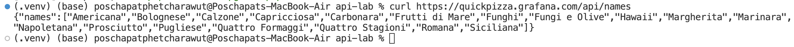
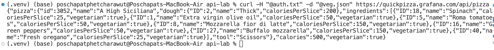
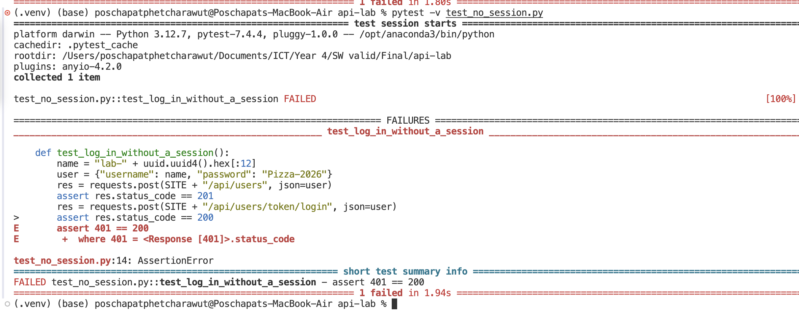

# API lab results

## Part 0
- Step 0.1, the number of pizza names: 18

- Step 0.3, status code of the request without a token: 401
- Step 0.4, the name of your pizza: A High Siciliana

- Step 0.12, results of the three runs without a session (optional): run 1: failed 401, run 2: failed 401, run 3: failed 401

- Step 0.16, blocks of "how many of the three tools are excluded": 0 tools, 1 tool, 2 tools, 3 tools (in total)
The original test only covered the "1 tool" case, so I’ve added the 0 and 2 cases to the `parametrize` decorator.
The case for 3 tools has been separated into its own test and marked as an `xfail`.

## Defect report
- Title: Excluding all three tools makes /api/pizza return 500 with an empty body
- Request: POST /api/pizza, header Authorization: token <token>, 
body {"excludedTools": ["Knife","Pizza cutter","Scissors"]}
- Expected result: status 400 and body is a JSON error message
- Actual result: status 500 and body empty
- Severity: Medium (Reason: The client actually sent input like this. The server crashed. 
But no data is damaged. and occurs only in extreme cases)

## Part A
- Step A4, status codes when the other user reads, changes and deletes:

## Part B
1.
2.
3.
4.
5.
6.
7.
8.