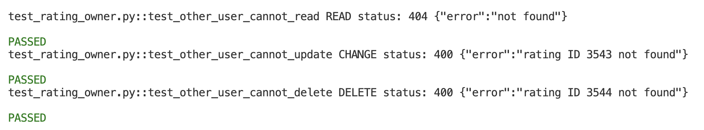

# API lab results

## Part 0
- Step 0.1, the number of pizza names: 18

- Step 0.3, status code of the request without a token: 401
- Step 0.4, the name of your pizza: A High Siciliana

- Step 0.12, results of the three runs without a session (optional): run 1: failed 401, run 2: failed 401, run 3: failed 401

- Step 0.16, blocks of "how many of the three tools are excluded": 
    * Block 1: 0 tools excluded (empty list [])
    * Block 2: 1 tool excluded (e.g. ["Knife"])
    * Block 3: 2 tools excluded (e.g. ["Knife", "Scissors"])
    * Block 4: 3 tools excluded (all tools: ["Knife", "Pizza cutter", "Scissors"])  
The original test only covered the "1 tool" case, so I’ve added the 0 and 2 cases to the `parametrize` decorator.
The case for 3 tools has been separated into its own test and marked as an `xfail`.

## Defect report
- Title: Excluding all three tools makes /api/pizza return 500 with an empty body
- Request: POST /api/pizza, header Authorization: token <token>, 
body {"excludedTools": ["Knife","Pizza cutter","Scissors"]}
- Expected result: status 400 and body is a JSON error message
- Actual result: status 500 and body empty
- Severity: Medium (Server crash/unhandled exception on valid user input; frontend cannot display meaningful error feedback)

## Part A
- Step A4, status codes when the other user reads, changes and deletes:
    * Read: 404 
    * Change (Update): 400
    * Delete: 400
    

## Part B

1. Actual testing on the server can find 2 things that unit tests + stubs cannot find, such as 
    - (a) setup/deployment problems, such as load balancer sending to a server that doesn't know the user
    - (b) incompatibility between different parts, such as the server returning 500 when encountering a certain type of input, or database/authentication not working properly. As for reasons why it is still a good idea to write unit tests + stubs: fast, deterministic results, not relying on the network, accurately pinpointing bugs in functions, and testing in case of errors. that are difficult to create on a real server

2. QuickPizza is shared by many people. If you use a public token, your data will collide with other people's. The test may fail, not related to the code (flaky), and we may modify other people's data. Therefore, let every test create its own random user name. The tests are therefore independent of each other. In Project 2, the same principles are used. That is, create your own product/order/room reservation with a unique name. Delete after testing. and do not touch the information of other groups

3. Use a single session to store the AWSALB cookie, causing the load balancer to send every request to the original server, which is the machine that knows the user we just created. If there is no session when logging in, it may fall to another machine and get a 401 
    - (if doing Step 0.12, tell the results of your own 3 runs, such as “How many times failed out of 3 without the code changing?”)  
    `3 fail out of 3`

4. The error encountered is: "3 tools excluded (all tools excluded)." 
Returning a 500 status code with an empty response body is problematic because the client/frontend cannot determine the root cause, preventing the display of a clear, actionable notification to the user and potentially causing the application to crash. 
We mark this test as `xfail` (expected failure) to keep the test suite "green" (passing) while still tracking the existence of this specific bug. And if the system developers fix this bug in the future, `strict=True` will immediately trigger an alert.

5. Base choice = 1 + (3−1) + (4−1) + (2−1) + (3−1) = 1 + 2 + 3 + 1 + 2 = 9 tests, all combinations = 3 × 4 × 2 × 3 = 72 tests

6. The actual code can be seen from the A4 results. What is expected is from a security perspective, the expected response code is either 403 Forbidden (if the resource is known to exist but the user lacks permission) or 404 Not Found (to conceal the existence of the data from unauthorized users). Receiving a 400 is an acceptable design choice to prevent information leakage and is not considered a critical flaw.

7. When executing `curl -H "@madeup.txt" https://quickpizza.grafana.com/api/ratings`
    - Result: Returns a "200 OK" status along with a list of all ratings in the system.
    - Assessment: This constitutes a defect and a critical security vulnerability (Broken Authentication / IDOR). In a real-world system, a malicious actor could use randomly generated tokens to access the personal data or transaction history of any user.

8. Aspects better verified by API testing than by web page testing: API tests excel at validating business logic, response status codes, headers, data schemas, and exception handling. They offer faster, more comprehensive coverage of all input edge cases, unconstrained by UI limitations.
Aspects that can only be verified through web page testing: UX/UI rendering, the accuracy of responsive layouts across various devices, fonts, colors, and the visual, interactive responses experienced by the user.